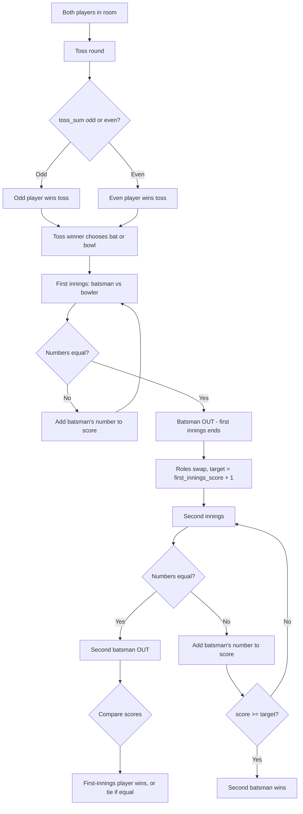
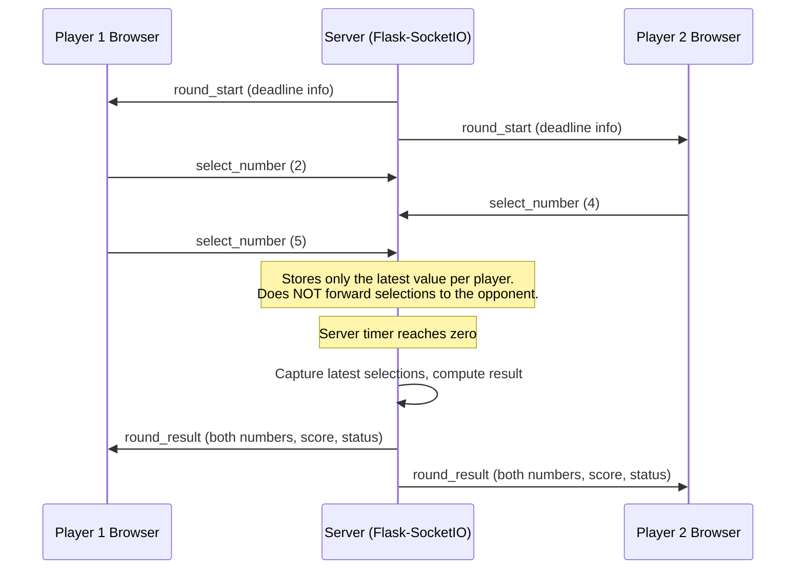
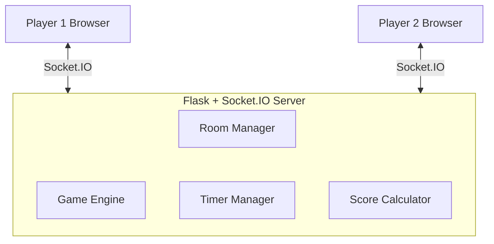
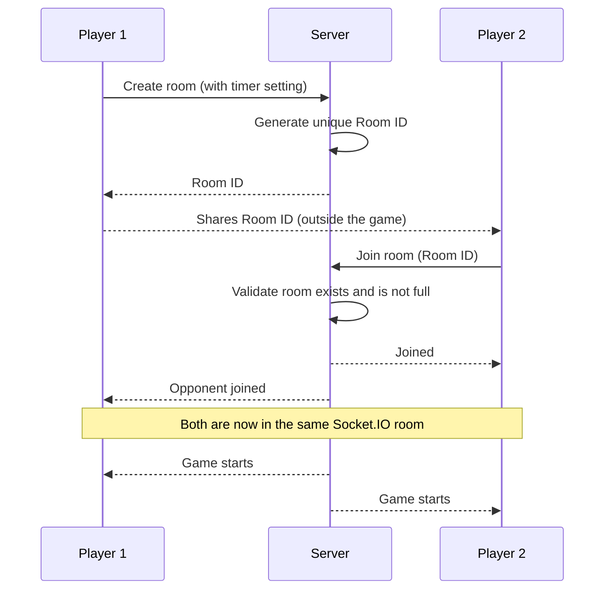
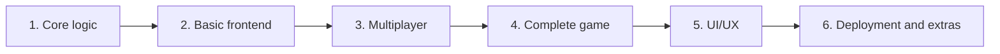

# ODD-EVE HAND CRICKET GAME

An online, two-player, browser-based version of the classic hand cricket game, built with Flask and Flask-SocketIO.

> **Project status: planning / early development.**
> This README describes the intended design of the project. Nothing described here should be assumed to be implemented unless it is explicitly marked **Implemented**. See [Implementation Status](#implementation-status).

---

## Table of Contents

1. [Project Overview](#project-overview)
2. [Features](#features)
3. [Complete Game Rules](#complete-game-rules)
4. [Timer and Number Selection Mechanism](#timer-and-number-selection-mechanism)
5. [Technology Stack](#technology-stack)
6. [System Architecture](#system-architecture)
7. [Room Management](#room-management)
8. [Project Folder Structure](#project-folder-structure)
9. [Development Roadmap](#development-roadmap)
10. [Installation and Setup](#installation-and-setup)
11. [Running the Project](#running-the-project)
12. [Testing](#testing)
13. [Engineering Principles](#engineering-principles)
14. [Security Considerations](#security-considerations)
15. [Future Improvements](#future-improvements)
16. [Contribution Guidelines](#contribution-guidelines)
17. [License](#license)

---

## Project Overview

**ODD-EVE HAND CRICKET GAME** is a website where two people can play hand cricket against each other online, in real time. It is a personal project made for fun with college friends.

It is a **website game**, not a native Android, iOS or desktop application. Players open it in a normal web browser.

A player can:

- Create a private game room.
- Get a unique Room ID.
- Share that Room ID with a friend.
- Join an existing room using a Room ID.
- Play a complete hand cricket match (toss, first innings, second innings) in real time.
- See scores, innings, the target and the final result.

### Implementation Status

| Area | Status |
|---|---|
| Project concept and rules | Documented (this README) |
| Core game logic (`game/`) | Planned |
| Basic frontend | Planned |
| Multiplayer with Flask-SocketIO | Planned |
| Server-side timer | Planned |
| Complete match flow | Planned |
| UI/UX polish | Planned |
| Deployment, match history, reconnection | Planned / future |

As features get built, update this table honestly.

---

## Features

Features are grouped by how certain they are.

**Planned for the first working version**

- Private rooms with a generated Room ID (maximum two players per room).
- Join by Room ID, with clear errors for invalid or full rooms.
- Room creator can configure the round timer.
- Toss based on the Odd/Even rule.
- Toss winner chooses to bat or bowl first.
- Two innings with a target for the second innings.
- Server-controlled countdown for every round.
- Simultaneous reveal of both players' numbers.
- Live scoreboard, innings indicator, target and match result.

**Planned for later versions**

- SQLite storage for match history and statistics.
- Shareable room links.
- Reconnection for disconnected players.
- Optional usernames and avatars.
- Public deployment.

Other ideas are listed in [Future Improvements](#future-improvements). They are not part of the initial scope.

---

## Complete Game Rules

A match has three phases:

1. Toss
2. First innings
3. Second innings



### Phase 1: Toss

The toss decides which player gets to choose whether to bat or bowl first.

1. Both players agree between themselves who takes **Odd** and who takes **Even**.
2. Each player selects a number from **1 to 6**.
3. Both players can change their selected number until the timer expires.
4. Selecting a number does **not** lock or submit it.
5. When the server-side timer reaches zero, the latest selection of each player is captured.
6. Both numbers are revealed simultaneously.
7. The server calculates the sum.

```text
toss_sum = player_1_number + player_2_number
```

| toss_sum | Winner |
|---|---|
| Even | The player who chose **Even** |
| Odd | The player who chose **Odd** |

The toss winner then chooses **batting first** or **bowling first**. The first innings starts only after this decision is made.

> Open question: the rules say both players "collectively decide" who is Odd and who is Even. The implementation needs to define how this is recorded (for example, the room creator picks Odd or Even, and the other player gets the remaining side, or the second player chooses). This is to be finalized.

### Phase 2: First Innings

The player who chooses to bat is the **batsman**. The other player is the **bowler**.

1. Both players select a number from 1 to 6.
2. Both can change their selection until the timer expires.
3. The server captures the latest selections when the timer reaches zero.
4. Both selections are revealed simultaneously.

```text
IF batsman_number == bowler_number:
    Batsman is OUT
ELSE:
    batsman_score += batsman_number
```

| Batsman | Bowler | Result |
|---|---|---|
| 2 | 4 | 2 runs |
| 5 | 1 | 5 runs |
| 6 | 6 | OUT |
| 3 | 3 | OUT |
| 1 | 5 | 1 run |

The process repeats round after round until the batsman gets OUT. The batsman's final score is the first-innings score.

### Phase 3: Second Innings

When the first batsman is OUT:

- The previous batsman becomes the bowler.
- The previous bowler becomes the batsman.

```text
target = first_innings_score + 1
```

The same number selection and comparison mechanism is used:

- If both numbers match, the second batsman is **OUT**.
- If they do not match, the batsman's number is added to their score.
- The second innings ends when the batsman gets OUT **or** reaches the target.

### Winning Conditions

| Situation | Result |
|---|---|
| Second batsman reaches the target | Second batsman wins |
| Second batsman is OUT below the target | First-innings player wins |
| Scores are equal after the innings end | Tie, if the rules allow it (see note) |

> Note on ties: with `target = first_innings_score + 1`, a second batsman who is OUT exactly on `first_innings_score` has tied the match. Whether a tie is a valid final result, or leads to a tie-breaker, is a policy still to be finalized. No tie-breaker is defined in the current rules.

### What is deliberately not in the rules

There are no overs, extra balls, wickets or other cricket rules. The game is exactly: toss, one innings per player, one OUT ends an innings. Any addition would be a future optional improvement and must not change these base rules.

---

## Timer and Number Selection Mechanism

This is the central mechanic of the game, and it differs from a normal "pick and submit" system.

### How a round works

1. A round starts.
2. The **server** starts a countdown.
3. Both players see number buttons from 1 to 6.
4. Players can click different buttons repeatedly.
5. A player's most recent click is their active selection.
6. They can change it any number of times until the countdown reaches zero.
7. At zero, the server captures both players' latest selections.
8. The server reveals both numbers simultaneously.
9. The game engine calculates the result.

### Example

| Time Remaining | Player 1 | Player 2 |
|---|---|---|
| 10 seconds | 2 | 4 |
| 7 seconds | 5 | 4 |
| 4 seconds | 5 | 6 |
| 1 second | 3 | 2 |
| 0 seconds | **3** | **2** |

Final captured values: Player 1 = 3, Player 2 = 2. If Player 1 is batting, the numbers differ, so Player 1 scores 3 runs.

### Sequence



### Technical requirements

- The timer is controlled by the **backend**.
- The browser countdown is **only a visual representation**.
- The server decides the actual deadline.
- Players must **not** see the opponent's current selection.
- Selections must **not** be broadcast to the other player before the reveal.
- The same mechanism is used for the toss and for both innings.
- Repeated selection changes are allowed until the server deadline.
- Selections that arrive after the server deadline are ignored.

### Timeout policy (to be finalized)

It is not yet decided what happens if a player never selects a number before the deadline. This is a policy decision, not something to silently invent in code. Options to choose from:

| Option | Description | Trade-off |
|---|---|---|
| Random number | Server picks a random number 1-6 for that player | Keeps the game moving, but gives the player an outcome they did not choose |
| Repeat last number | Reuse the player's previous round's number | Predictable, can be exploited by an opponent |
| Skip and replay the round | Void the round and start it again | Fair, but can stall indefinitely |
| Forfeit after N missed rounds | Match ends if a player misses N rounds in a row | Handles abandoned games, needs a grace-period setting |

Whichever option is chosen must be documented here and covered by tests. A short **grace period** for network latency at the deadline is also undecided.

---

## Technology Stack

The first version intentionally keeps the stack small.

### Frontend

| Technology | Purpose |
|---|---|
| HTML5 | Page structure, game screens, create/join room forms, scoreboard, number buttons |
| CSS3 | Styling, responsive layout, animations, dark gaming theme |
| Vanilla JavaScript | Button interactions, number selection, countdown display, frontend state, Socket.IO client communication |

React is deliberately not used in the first version, because the UI is a handful of screens and does not need a frontend framework yet.

### Backend

| Technology | Purpose |
|---|---|
| Python | Core language: toss logic, innings logic, score calculation, winner determination |
| Flask | Web framework: routes, serving HTML templates, application structure |
| Flask-SocketIO | Real-time communication: room-based multiplayer, receiving selections, broadcasting results, keeping both players in sync |

### Database

| Stage | Storage |
|---|---|
| Initial | Active rooms and matches live in **server memory** |
| Later | **SQLite** for match history, player statistics, match results and player profiles |
| Possible future | **Redis**, only if shared real-time state across multiple server instances is needed |

Note: in-memory state is lost when the server restarts, and it only works with a single server process. That is acceptable for a first version for friends.

### Tooling and Deployment

| Technology | Purpose |
|---|---|
| Git and GitHub | Version control, collaboration, documentation |
| Render (or another host) | Public hosting. The host must support persistent WebSocket connections |

**Local development vs public deployment**

| | Local development | Public deployment |
|---|---|---|
| Address | `http://127.0.0.1:5000` | A public HTTPS URL |
| Who can play | Only browsers on your machine (or your local network) | Anyone with the link |
| Debug mode | May be on | Must be off |
| Protocol | HTTP / WS | HTTPS / WSS |
| Server | Flask development server | A production-capable server that supports WebSockets |
| Secret key | Any placeholder | Strong, private, set through environment variables |

---

## System Architecture



### Backend components

| Component | Responsibility |
|---|---|
| Room Manager | Creates rooms, generates unique Room IDs, validates joins, tracks the two players, cleans up rooms |
| Game Engine | Holds match state and moves it through toss, first innings, second innings and finished |
| Timer Manager | Owns the real deadline of each round and triggers the capture/reveal at zero |
| Score Calculator | Pure functions: OUT detection, run addition, target, winner |

### The backend is the authority

The server is the single source of truth for:

- Game state
- The timer
- Player selections
- Toss calculation
- Score calculation
- Winner determination

The frontend only displays information and sends player actions. It must never decide the final match result on its own.

---

## Room Management

### Workflow



1. Player 1 opens the website.
2. Player 1 clicks **Create Room**.
3. The server generates a unique Room ID.
4. Player 1 shares that ID with a friend.
5. Player 2 enters the Room ID.
6. The server validates the room.
7. Both players join the same Socket.IO room.
8. The game starts after both players have joined.

### Room requirements

- Maximum two players per room.
- Room IDs are unique.
- The room creator can configure the timer.
- A room must not start with only one player.
- Invalid or full rooms show an error message.
- Reconnecting a disconnected player is a future feature.

---

## Timer Configuration

The room creator sets the round timer in seconds when creating the room.

| Preset | Seconds |
|---|---|
| Fast | 5 |
| Default (suggested) | 10 |
| Relaxed | 15 |
| Long | 20 |
| Custom | Any integer within a defined limit |

The minimum and maximum allowed custom values are still to be decided (for example, 3 to 60 seconds) and must be enforced on the server.

The server stores the configured duration with the room. When a round starts, the server computes the deadline from its own clock. The clients may receive the remaining time only to draw a countdown. At the deadline, the server captures each player's latest stored selection and runs the reveal. A browser that shows "0" early or late changes nothing.

---

## Project Folder Structure

This is the **intended** structure. None of these files are guaranteed to exist yet. When a file is actually implemented, mark it in the "Status" column.

```text
odd-even-hand-cricket/
│
├── app.py
├── config.py
├── requirements.txt
│
├── game/
│   ├── __init__.py
│   ├── engine.py
│   ├── toss.py
│   ├── innings.py
│   └── scoring.py
│
├── rooms/
│   ├── __init__.py
│   └── room_manager.py
│
├── sockets/
│   ├── __init__.py
│   └── events.py
│
├── templates/
│   ├── index.html
│   ├── lobby.html
│   └── game.html
│
├── static/
│   ├── css/
│   │   └── style.css
│   ├── js/
│   │   ├── main.js
│   │   ├── game.js
│   │   └── socket.js
│   └── images/
│
├── tests/
│   ├── test_toss.py
│   ├── test_innings.py
│   └── test_scoring.py
│
├── README.md
└── .gitignore
```

### Responsibilities

| Path | Responsibility | Status |
|---|---|---|
| `app.py` | Application entry point. Creates the Flask app, initializes Socket.IO, registers routes and event handlers | Planned |
| `config.py` | Configuration: secret key, debug flag, timer limits, room settings. Sensitive values should come from environment variables | Planned |
| `requirements.txt` | Python dependencies | Planned |
| `game/` | Pure game logic. No Flask or Socket.IO imports | Planned |
| `game/engine.py` | Match state machine: toss, first innings, second innings, finished | Planned |
| `game/toss.py` | Toss sum, Odd/Even winner | Planned |
| `game/innings.py` | Batsman/bowler roles, round resolution, role swap, innings end | Planned |
| `game/scoring.py` | OUT detection, run addition, target calculation, winner determination | Planned |
| `rooms/` | Room lifecycle and membership | Planned |
| `rooms/room_manager.py` | Create room, generate Room ID, join, leave, enforce two-player limit, cleanup | Planned |
| `sockets/` | Real-time layer | Planned |
| `sockets/events.py` | Socket.IO event handlers. Validates input, calls the game engine and room manager, emits updates. Should contain no game rules itself | Planned |
| `templates/index.html` | Home page: create room and join room forms | Planned |
| `templates/lobby.html` | Waiting screen showing the Room ID until the second player joins | Planned |
| `templates/game.html` | Main game screen: number buttons, timer, scoreboard, results | Planned |
| `static/css/style.css` | Styling and theme | Planned |
| `static/js/main.js` | Home page logic (create/join forms) | Planned |
| `static/js/game.js` | In-game UI: number selection, countdown display, scoreboard updates | Planned |
| `static/js/socket.js` | Socket.IO client connection and event wiring | Planned |
| `static/images/` | Images and icons | Planned |
| `tests/` | Automated tests for the game rules | Planned |
| `.gitignore` | Excludes virtual environment, caches, local config and database files from Git | Planned |

---

## Development Roadmap

Development is incremental: get the rules right first, then the interface, then multiplayer.



### Phase 1: Core Game Logic

- Toss calculation and Odd/Even winner
- Batting and bowling roles
- OUT detection
- Scoring
- Target calculation
- Winner determination
- Test everything from the terminal, without any web code

### Phase 2: Basic Frontend

- Home page
- Create-room form and join-room form
- Number buttons 1 to 6
- Timer display
- Scoreboard

### Phase 3: Multiplayer Integration

- Integrate Flask-SocketIO
- Create and join rooms
- Connect two players
- Synchronize the game
- Server-side timer
- Latest-selection capture
- Simultaneous reveal

### Phase 4: Complete Game

- Toss
- Toss winner's decision
- First innings
- Second innings
- Target
- Winner declaration

### Phase 5: UI/UX Improvements

- Dark theme
- Cricket-inspired visuals
- Animations
- Sound effects
- Responsive design
- Better scoreboard

### Phase 6: Deployment and Additional Features

- Public deployment
- Shareable room links
- Reconnection
- Match history
- Player statistics
- Optional usernames and avatars

| Phase | Status |
|---|---|
| 1. Core game logic | Not started |
| 2. Basic frontend | Not started |
| 3. Multiplayer integration | Not started |
| 4. Complete game | Not started |
| 5. UI/UX improvements | Not started |
| 6. Deployment and additional features | Not started |

Update this table as work progresses.

---

## Installation and Setup

These steps are for **Windows** and assume Python 3 and Git are installed. They only work once the planned files actually exist in the repository.

### 1. Clone the repository

```powershell
git clone <YOUR-REPOSITORY-URL>
cd odd-even-hand-cricket
```

Replace `<YOUR-REPOSITORY-URL>` with the real GitHub URL of this project.

### 2. Open the project in VS Code

```powershell
code .
```

### 3. Create a virtual environment

```powershell
python -m venv venv
```

### 4. Activate the virtual environment

PowerShell:

```powershell
.\venv\Scripts\Activate.ps1
```

If PowerShell blocks the script, run this once for your user and try again:

```powershell
Set-ExecutionPolicy -Scope CurrentUser -ExecutionPolicy RemoteSigned
```

Command Prompt (cmd):

```bat
venv\Scripts\activate.bat
```

When active, your prompt starts with `(venv)`.

### 5. Install dependencies

```powershell
pip install -r requirements.txt
```

Sample `requirements.txt`:

```text
Flask
Flask-SocketIO
```

> Dependency versions should eventually be pinned (for example, with `pip freeze > requirements.txt` after a working install) so that everyone gets reproducible installations.

---

## Running the Project

### 6. Run the Flask application

```powershell
python app.py
```

### 7. Open the local website

Go to:

```text
http://127.0.0.1:5000
```

### 8. Test with two browser sessions

Two players are needed, so you need two separate sessions on one machine:

1. Open the site in a normal browser window and click **Create Room**. Note the Room ID.
2. Open a second session: a private/incognito window, or a different browser.
3. Open the site there and join using the Room ID.
4. Play a match by controlling both windows.

To test across devices on the same Wi-Fi, the server must listen on a network address and the firewall must allow it. This is not set up by default.

---

## Testing

The game rules are pure logic, kept separate from Flask and Socket.IO, so they can be tested without a browser or server.

Planned test files:

| File | Covers |
|---|---|
| `tests/test_toss.py` | Odd/Even sum, toss winner for all 36 number pairs |
| `tests/test_innings.py` | Role assignment, role swap, OUT detection, innings end |
| `tests/test_scoring.py` | Run addition, target calculation, win/lose/tie determination |

Cases worth covering:

- Equal numbers means OUT, for every value 1 to 6.
- Different numbers add the batsman's number.
- First-innings score of 0 gives a target of 1.
- Second batsman reaching the target ends the match immediately.
- Second batsman OUT below, at, and above the target boundary.
- Invalid numbers (0, 7, negative, non-integer) are rejected.
- Selections after the deadline are ignored.

Run the tests from the project root with Python's built-in test runner (no extra dependency needed):

```powershell
python -m unittest discover -s tests
```

Current test status: **no tests exist yet.**

---

## Engineering Principles

- The backend is the source of truth.
- The frontend only displays game information and sends player actions.
- Never reveal the opponent's current selection before the deadline.
- Never trust the browser's timer to decide when a round ends.
- Validate all player input on the server.
- Keep game logic separate from Socket.IO event handlers.
- Keep room management separate from score calculations.
- Write automated tests for the game rules.
- Do not add unnecessary dependencies.
- Build functionality before visual polish.

---

## Security Considerations

This is a small friends-only project, but a public deployment still needs basic care.

| Concern | Planned handling |
|---|---|
| Room membership | Only players in a room may send events for it. Check on every event |
| Unauthorized events | Verify the sender's identity and role (for example, only the toss winner can choose bat/bowl, only the current phase accepts number selections) |
| Input validation | Accept only integers 1 to 6, and validate room IDs and timer values on the server |
| Session tokens | Protect player session tokens and never log or expose them |
| Transport | Use HTTPS and WSS in deployment |
| Private data | Never expose another player's private data, including their current selection |
| Secret key | Use a strong random secret key, kept out of Git and loaded from an environment variable |
| Debug mode | Disable Flask debug mode in production |
| Abuse | Add rate limiting before public release |
| Resource use | Add room cleanup (abandoned and finished rooms) before public release |

---

## Future Improvements

These are **ideas only**, not mandatory initial features and not part of the current scope:

- Better gaming UI
- Player avatars
- Sound effects
- Toss animations
- Match history
- Leaderboard
- Player statistics
- Reconnection handling
- Rematch option
- Spectator mode
- Custom themes
- Private room passwords
- Mobile-responsive design
- Best-of-three match mode

Any of these that change the match rules (for example, best-of-three) must be added as optional modes and must not alter the base rules above.

---

## Contribution Guidelines

This is a personal project, but friends are welcome to help.

1. Read this README, especially [Complete Game Rules](#complete-game-rules) and [Engineering Principles](#engineering-principles).
2. Create a new branch for each change:
   ```powershell
   git checkout -b feature/short-description
   ```
3. Keep game rules out of the Socket.IO handlers. Put them in `game/`.
4. Add or update tests when you change game logic.
5. Do not add a new dependency without a clear reason.
6. Do not mark a feature as implemented in this README until it works.
7. Open a pull request describing what changed and how you tested it.

---

## License

**Undecided.** No license has been chosen yet. Until one is added, the default is that all rights are reserved by the author.